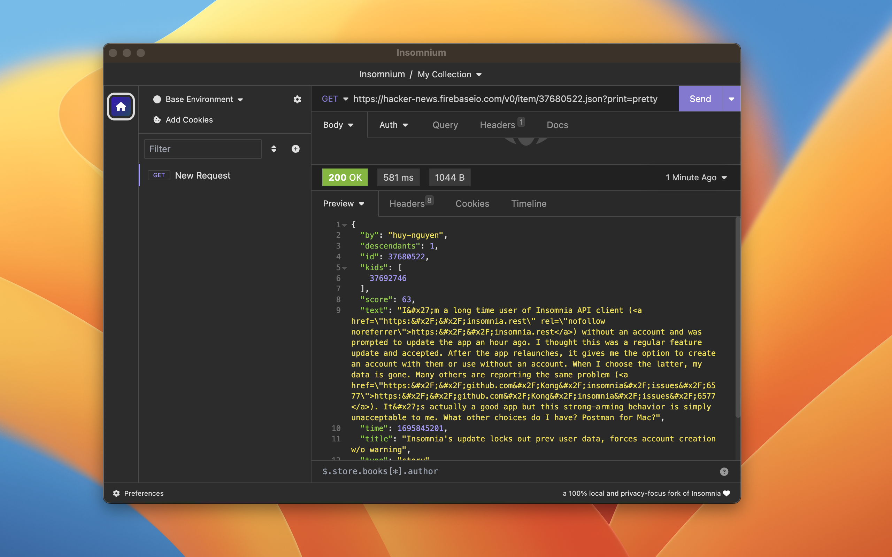
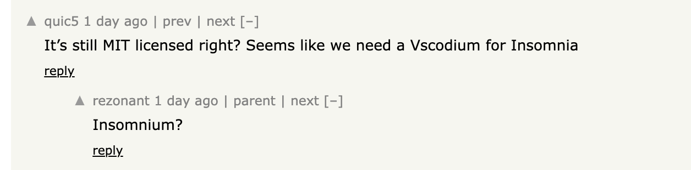

> [!NOTE]
> This is the README of the original Insomnium fork (`ArchGPT/insomnium`), kept here for history. That fork was
> unfortunately nuked, and that is what inspired me to start working on a proper fork:
> [this project](../../README.md). Links to the old repository may no longer work.

# Insomnium API Client

Insomnium is a 100% local and privacy-focused open-source API client for testing GraphQL, REST, WebSockets, Server-sent
events and gRPC in development/production.

- ✅ works 100% offline, the way a local testing tool should behave <br>
- ✅ no cloud services, no tracking/communication to external servers behind the scene <br>
- 🦙 (coming up) optional integration to local LLMs like CodeLlama for front-end code generation in React, Vue, htmx,
  etc, based on the API response JSON

[](https://github.com/ArchGPT/insomnium/blob/main/LICENSE)
[](https://github.com/ArchGPT/insomnium/discussions)
[](https://discord.gg/pCcWcncwkw)



## Backstory

Insomnium is a fork of [Kong/insomnia at 2023.5.8](https://github.com/ArchGPT/insomnia), the last commit before
compulsory account login was introduced. In a sense, Insomnium is a community response to
[the latest product update that forces account creation w/o warning](https://news.ycombinator.com/item?id=37680522).



I was among the users who were deeply affected by the recent change. I still think Insomnia is a nice product in
general, but I have to disagree with the direction it is going. So I have decided to fork it and make it 100% local and
privacy-focused.

> _I choose to walk in shades._ <br> > _Hearken now, to the song of dusk_ <br> > _The forest venerates your name_ <br>
> --- [Insomnium, song of the dusk](https://youtu.be/nTIDh1miBSc)

## Roadmap

I have removed user login, tracking, analytics, etc, from Insomnia so it is now a 100% local app. (And runs faster!)

I have also added Ollama and GPT4 support for Insomnium.

If you have any feature request or encountered any bug, feel free to
[open an issue](https://github.com/ArchGPT/insomnium/issues). Thanks! I'm also working on a Code Llama plugin for
Insomnium to make it more easily customizable and extensible, while keeping the core product fast and 100% local-only.
[You can read more about Insomnium's roadmap here](https://github.com/ArchGPT/insomnium/discussions/13).

## Download

Insomnium is available for Mac, Windows, Ubuntu, Debian, CentOS, Fedora and
[can be downloaded here](https://github.com/ArchGPT/insomnium/releases). Insomnium is also
[available on AUR for ArchLinux](https://aur.archlinux.org/packages/insomnium-bin).

Alternatively, you can build Insomnium from source on your local machine using `npm run app-package`.

## Migration from Insomnia

You can use the GUI (under `Preferences/Data`) or directly e.g. for linux
`cp -r ~/.config/Insomnia ~/.config/Insomnium`.
[For MacOS and Windows, you can read more here](https://archgpt.dev/insomnium/migration-guide). Feel free to open an
issue/discussion if anything weird happens.

## Develop Insomnium

Development on Insomnium can be done on Mac, Windows, or Linux as long as you have [Node.js](https://nodejs.org) and
[Git](https://git-scm.com/). See the `.nvmrc` file located in the project for the correct Node version.

<details>
<summary>Initial Dev Setup</summary>

This repository is structured as a monorepo and contains many Node.JS packages. Each package has its own set of
commands, but the most common commands are available from the root [`package.json`](package.json) and can be accessed
using the `npm run …` command. Here are the only three commands you should need to start developing on the app.

```shell
# Install and Link Dependencies
npm i

# Run Lint
npm run lint

# Run type checking
npm run type-check

# Run Tests
npm test

# Start App with Live Reload
npm run dev
```

### Linux

If you are on Linux, you may need to install the following supporting packages:

<details>
<summary>Ubuntu/Debian</summary>

```shell
# Update library
sudo apt-get update

# Install font configuration library & support
sudo apt-get install libfontconfig-dev

# Install libcurl for node-libcurl
sudo apt-get install libcurl4-openssl-dev
```

</details>

<details>
<summary>Fedora</summary>

```shell
# Install libcurl for node-libcurl
sudo dnf install libcurl-devel
```

</details>

Also on Linux, if Electron is failing during the install process, run the following

```shell
# Clear Electron install conflicts
rm -rf ~/.cache/electron
```

### Windows

If you are on Windows and have problems, you may need to install
[Windows Build Tools](https://github.com/felixrieseberg/windows-build-tools)

</details>

<details>
<summary>Editor Requirements</summary>

You can use any editor you'd like, but make sure to have support/plugins for the following tools:

- [ESLint](http://eslint.org/) - For catching syntax problems and common errors
- [JSX Syntax](https://facebook.github.io/react/docs/jsx-in-depth.html) - For React components

</details>

## Bugs and Feature Requests

Before submitting a bug or a feature request, you can read the
[issue guidelines](CONTRIBUTING.md#using-the-issue-tracker).

## Contributing

Please read through our [contributing guidelines](CONTRIBUTING.md) and [code of conduct](CODE_OF_CONDUCT.md). Included
are directions for opening issues, coding standards, and notes on development.

<!-- ## Documentation

Check out our open-source [Insomnium Documentation](https://archgpt.dev/insomnium-doc). -->

## License

[MIT](https://github.com/ArchGPT/insomnium/blob/main/LICENSE)
