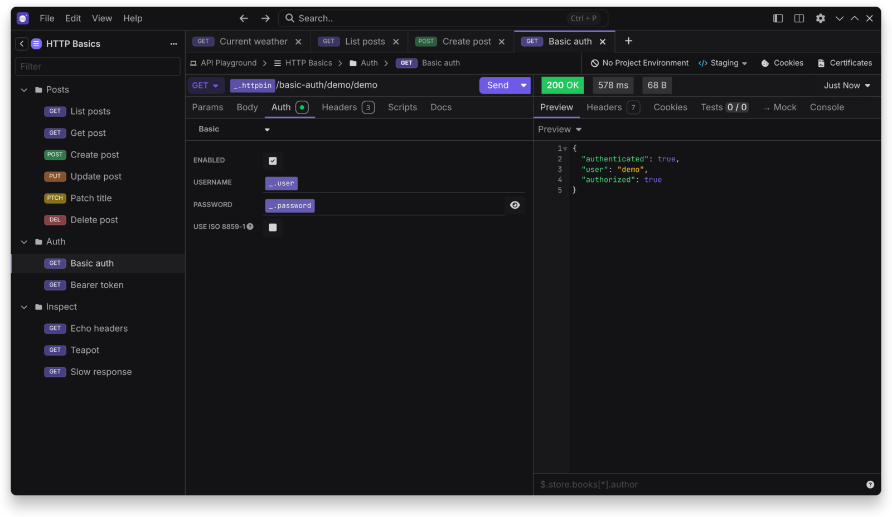

# Authentication

Restless supports these request auth types:

- Basic
- Digest
- OAuth 1
- OAuth 2
- NTLM
- AWS IAM
- Bearer token
- API key
- Hawk
- Netrc
- ASAP



## OAuth 2 in your browser

Turn on **Using default browser** on the OAuth 2 tab. Register this redirect URL with your provider:

```text
http://127.0.0.1:53682/callback
```

Restless listens on that address only during sign-in, and checks the `state` value on the way back. The authorization code never passes through a relay server.
