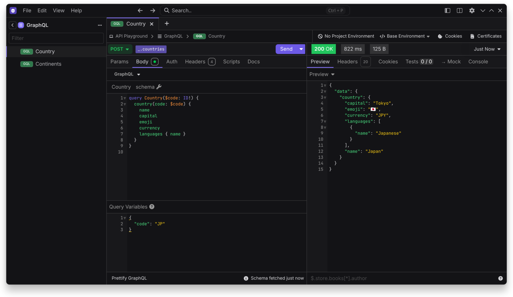
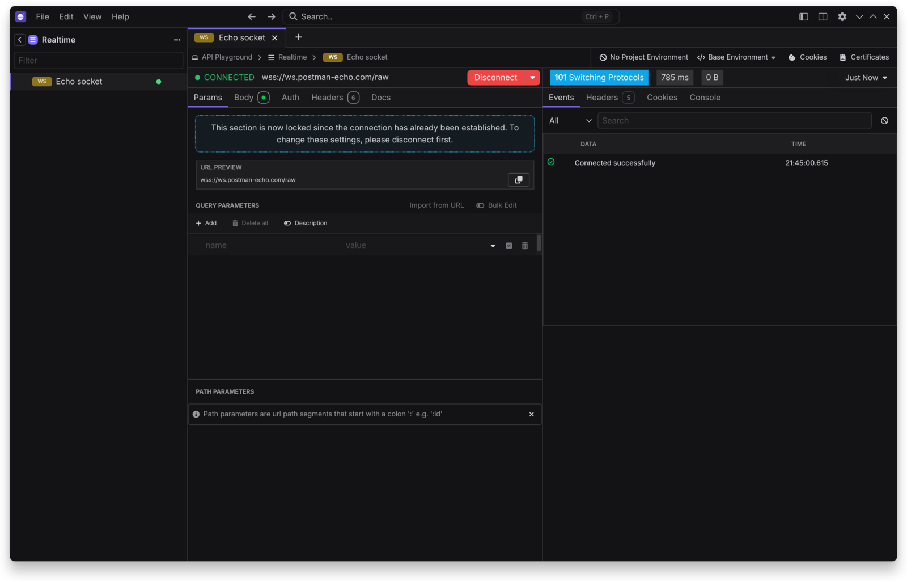
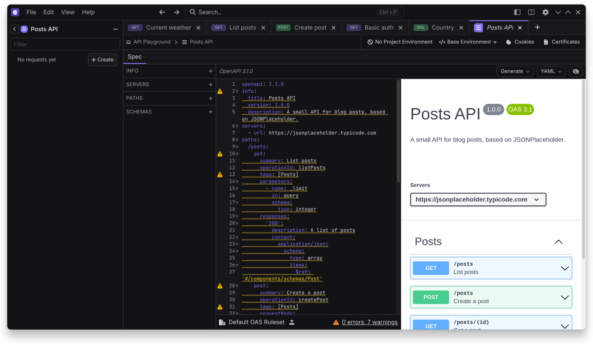
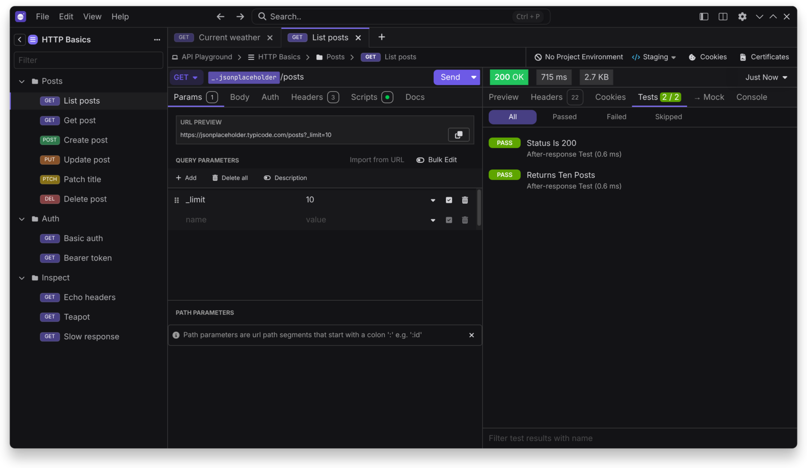

# Features

## Protocols

REST, GraphQL, gRPC, WebSockets, Server-Sent Events, Socket.IO and SOAP through WSDL import. The MCP client is available when [AI features](Optional-Services#ai-and-mcp) are on.

## Debugging

- Environments, template tags and request chaining
- Pre-request and after-response scripts
- Cookies, client certificates and proxy settings
- Response history, filtering and timeline
- Code generation for many languages
- See [Authentication](Authentication) for auth methods

## Design

- OpenAPI editor with visual preview
- Spectral linting with custom rules
- Generate a collection from a spec

## Testing

- Collection runner with iterations and data files
- Unit test suites
- Script assertions
- [Command line](Command-Line) runs for CI

## Mocking

Create mock routes and serve them from a self-hosted mock server.

## Git

Commits, branches, history, diffs and merge conflict handling, with or without a remote. See [Storage and Git](Storage-and-Git).

## Import and export

- Import: Insomnia, Postman, OpenAPI, Swagger, HAR, cURL and WSDL
- Export: Insomnia YAML and JSON, and HAR

## Customization

Themes, accent colors, keyboard shortcuts, fonts and [plugins](Plugins-and-Themes).
