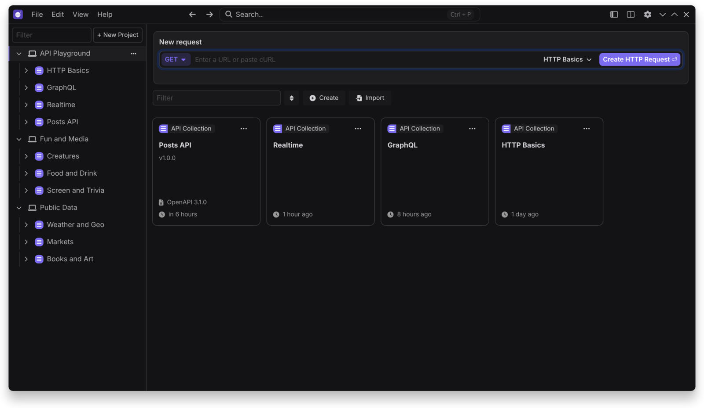
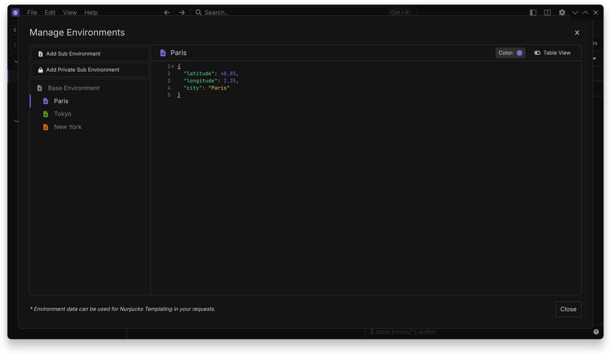
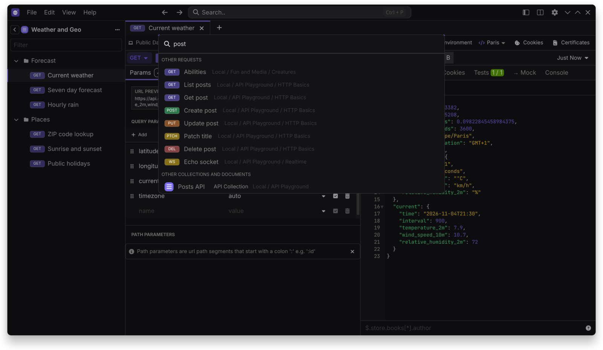

# Getting Started

Restless opens straight into a local project called `My Project`, with a collection called `My Collection`. There is nothing to sign in to.

## Send a request

1. Paste a URL or a cURL command into **New request**.
2. Choose a method and press `Enter`.
3. Press `Ctrl+Enter` to send it (`Cmd+Enter` on macOS).

## Organize your work

- A **project** groups collections, API specs, mock servers and environments.
- A **collection** holds requests and folders.
- An **environment** holds variables, used as `{{ _.variable_name }}`.

Press `Ctrl+P` to search everything.

## Keep it in Git

Use `File > Open Folder…` to work from a folder on disk. See [Storage and Git](Storage-and-Git).

## Useful shortcuts

| Action | Shortcut |
|---|---|
| Send request | `Ctrl+Enter` |
| Focus URL | `Ctrl+L` |
| Search | `Ctrl+P` |
| Edit cookies | `Ctrl+K` |
| Environments | `Ctrl+E` |
| All shortcuts | `Ctrl+Shift+/` |

Use `Cmd` instead of `Ctrl` on macOS. You can change shortcuts in `Preferences > Keyboard`.
