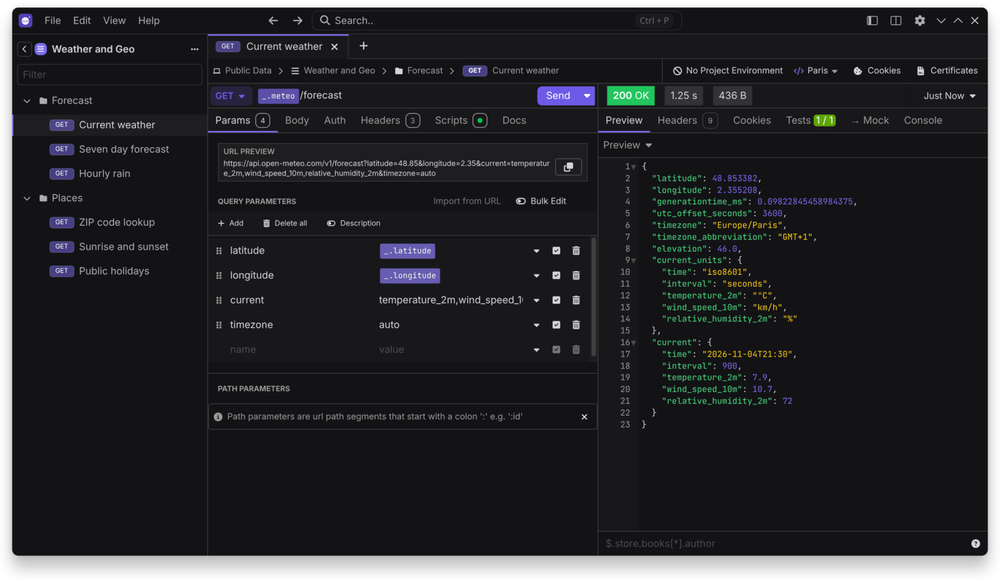

# Restless

Restless is an offline-first API client for REST, GraphQL, gRPC, WebSockets, Server-Sent Events and Socket.IO. It needs no account, sends no telemetry, and keeps your data on your machine.

Restless started as a fork of Kong's Insomnia. It is independent and not affiliated with Kong.

## Start here

- [Installation](Installation)
- [Getting Started](Getting-Started)
- [Features](Features)
- [Migrating from Insomnia](Migration)

## Using Restless

- [Storage and Git](Storage-and-Git)
- [Authentication](Authentication)
- [Optional Services](Optional-Services)
- [Command Line](Command-Line)
- [Plugins and Themes](Plugins-and-Themes)
- [Privacy](Privacy)

## Building Restless

- [Architecture](Architecture)
- [Development](Development)
- [Testing](Testing)
- [Releasing](Releasing)
- [Distribution](Distribution)

## Project

- [Principles](Principles)
- [Roadmap](Roadmap)
- [Decisions](Decisions)
