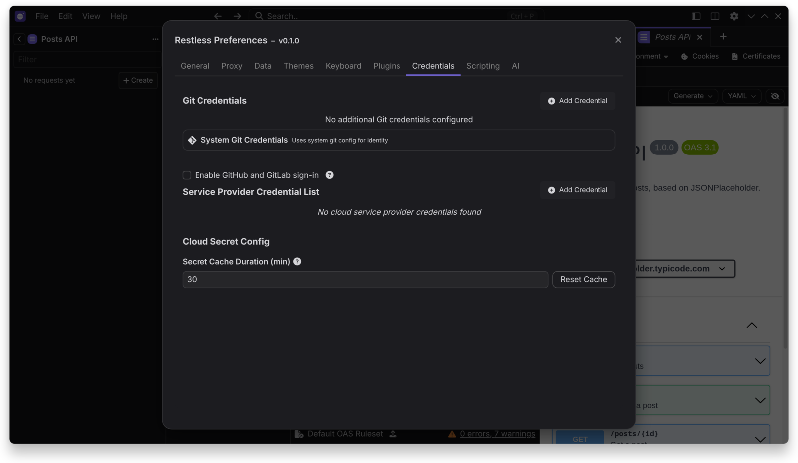

# Optional Services

Everything here is off until you turn it on.

## GitHub and GitLab sign-in

Access tokens work without any of this. To use sign-in:

1. Open `Preferences > Credentials`.
2. Turn on **Enable GitHub and GitLab sign-in**.
3. Add your client ID.

| Provider | What to create | Flow |
|---|---|---|
| GitHub | An OAuth app with device flow enabled | Device flow, enter a code in your browser |
| GitLab | A non-confidential application with redirect URI `http://127.0.0.1:53682/callback` | PKCE |

Neither needs a client secret.

## AI and MCP

Turn on **Enable AI features** in `Preferences > AI`.

That shows:

- Smart commits
- AI mock server generation
- The MCP client

Supported providers:

- Anthropic
- OpenAI
- Google Gemini
- Any OpenAI-compatible URL, including local servers such as Ollama and llama.cpp

Requests go directly from your machine to the provider you choose, using your own API key.

## Secret managers

Add a credential in `Preferences > Credentials`, then use the **External Vault** template tag in a request or environment.

| Provider | Supported credentials |
|---|---|
| HashiCorp Vault | Self-hosted, Dedicated and HCP, by token or AppRole |
| AWS Secrets Manager | Temporary keys or a credentials file |
| GCP Secret Manager | Service account key file |

Values are masked in previews. AWS SSO profiles and Azure Key Vault are planned.
