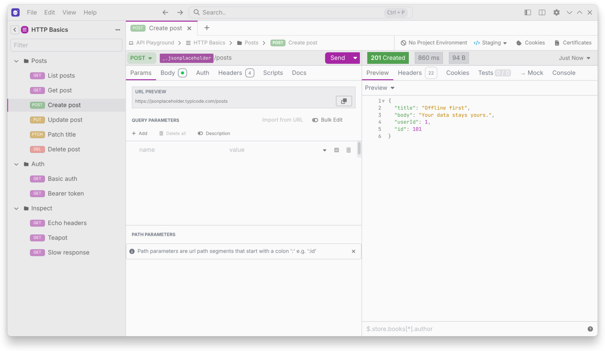

# Plugins and Themes

Restless loads Insomnia plugins.

## Install a plugin

Open `Preferences > Plugins` and enter its npm package name. You can search npm for packages tagged [`insomnia`](https://www.npmjs.com/search?q=keywords%3Ainsomnia).

Plugins run code on your machine, so only install ones you trust.

## Insomnia web links

Restless opens `insomnia://` links for plugin installs, theme installs and imports. Every other `insomnia://` link is ignored.

This is on by default. Turn off **Open Insomnia web links** in `Preferences > General` if you also use Insomnia. The change applies after a restart.

## Themes

Choose a theme in `Preferences > Themes`. Turn on **Use OS color scheme** to pick separate light and dark themes that follow your system.

## Built-in plugin

`restless-plugin-secret-managers` powers the **External Vault** template tag. See [Optional Services](Optional-Services#secret-managers).
