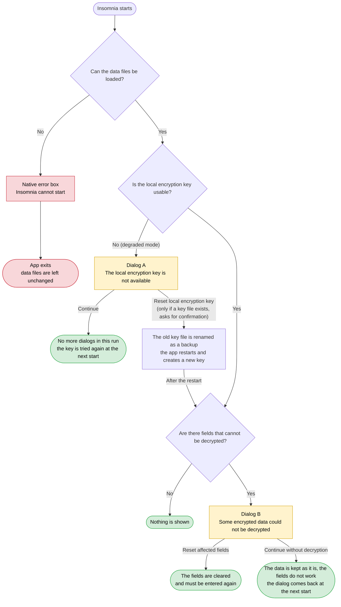

# NeDB Local Database Field-Level Encryption Design

## 1. Background & Goals

Insomnia uses NeDB as its local embedded database, storing users' API requests, authentication credentials, and other data. This data is saved as plaintext JSON in `.db` files, posing a risk of sensitive information exposure (e.g., auth tokens, passwords, certificate private keys). This was flagged as a security risk in a recent penetration test ([INS-2368](https://konghq.atlassian.net/browse/INS-2368)).

**Goal:** Implement encryption at rest for sensitive fields in local `.db` files, with automatic encryption/decryption during normal application use, fully transparent to users and to the business logic layer.

**Terminology:** A **datastore** is one NeDB `Datastore`, persisted as one `insomnia.<Type>.db` file. There is one datastore per model type (44 in total). This is unrelated to an Insomnia **Collection**, which is a Workspace with `scope: 'collection'` stored as a document in `insomnia.Workspace.db`.

## 2. Sensitive Fields Analysis

An audit of all 40+ data models identified 12+ models containing sensitive fields, with nesting depths of 1–3 levels:

| Model                                           | Sensitive Field Paths                                                                                                                           | Nesting Depth |
| ----------------------------------------------- | ----------------------------------------------------------------------------------------------------------------------------------------------- | ------------- |
| Request                                         | `authentication.*`: `password`, `token`, `value`, `key`, `clientSecret`, `accessToken`, `refreshToken`, `secretAccessKey`, `sessionToken`, `accessKeyId`, `privateKey`, `consumerSecret`, `tokenSecret` (see the field list below) | 2             |
| ClientCertificate                               | `passphrase`, `cert`, `key`, `pfx`                                                                                                              | 1             |
| GitCredentials                                  | `token`, `refreshToken` (legacy top-level), `credentials.token`, `credentials.refreshToken`, `credentials.password`                            | 1–2           |
| CloudCredential                                 | `credentials.accessKeyId`, `.secretAccessKey`, `.sessionToken`, `.client_secret`, `.secret_id`, `.access_token`, `.accessToken`                 | 2             |
| OAuth2Token                                     | `accessToken`, `refreshToken`, `identityToken`                                                                                                  | 1             |
| CookieJar                                       | `cookies[].value`                                                                                                                               | 2             |
| GrpcRequest                                     | `reflectionApi.apiKey`                                                                                                                          | 2             |
| Workspace (collection-level authentication) / RequestGroup (folder) / WebSocketRequest / SocketIORequest / McpRequest | Same authentication fields as Request. They share the `AuthenticationSchema`, so the same marks cover them                                     | 2             |
| RequestVersion                                  | `compressedRequest` — gzip + base64 snapshot of the full request (including `authentication`), written on every send of a changed request      | 1             |

**Characteristics:** Sensitive fields are mostly `string` types, often nested inside `authentication` objects or array elements.

**Authentication field list:** The 13 authentication types share one schema, and the encrypted names are the union over all of them: `password` (Basic, Digest, NTLM, OAuth2), `token` (Bearer, SingleToken), `value` (API Key), `key` (Hawk), `clientSecret`, `accessToken`, `refreshToken` (OAuth2), `consumerSecret`, `tokenSecret`, `privateKey` (OAuth1 and ASAP), `secretAccessKey`, `sessionToken` and `accessKeyId` (AWS IAM). Identifier-like and short-lived values are not encrypted: `clientId`, `tokenKey`, Hawk `id`, ASAP `keyId`, OAuth2 `code` and `state`, OAuth1 `verifier`. Because names are merged across the union (4.4), API Key auth's `key` (a header name) is encrypted as well.

**Sensitive data inside opaque values:** A field that embeds sensitive data in an encoded form is encrypted as a whole string. RequestVersion's `compressedRequest` is a gzip + base64 copy of the entire request, so encrypting only the Request's `authentication.*` fields would leave the same secrets readable in `insomnia.RequestVersion.db`.

**Out of scope — legacy Git repository credentials:** `GitRepository.credentials` (`username` with `password` or `token`) is a deprecated field that a startup migration moves to GitCredentials and sets to `null`. It is not encrypted; values that are still present before the migration has run stay plaintext.

**Out of scope — confidential environment variables:** Environment variables can be flagged as confidential (`kvPairData[].isConfidential`, serialized as `confidentialKeys` in v5 export and Git Sync YAML). This flag is a display-masking policy (preview, timeline, generated code) and does not change how values are stored. This design does **not** encrypt confidential variables; their values remain plaintext in the local database. Environment variables of type `SECRET` are already encrypted by the Vault.

## 3. Approaches Explored & Comparison

The design space was evaluated along two dimensions: **where** to perform encryption (the layer) and **what key** to use (the key management strategy).

### 3.1 Dimension 1: Encryption Layer

**Note on "Query Impact":** NeDB keeps all documents in memory for querying. If encryption happens _above_ the in-memory layer (e.g., at the DB method level), in-memory data contains ciphertext, and queries like `find({ 'authentication.token': 'secret123' })` will fail because the stored value is encrypted. If encryption happens _below_ the in-memory layer (e.g., at the serialization/disk layer), in-memory data is always plaintext, so all queries work normally regardless of which fields are encrypted.

| Approach                                                       | Description                                                                                                                                                                                                   | Query Impact                                               | Code Invasiveness                                                                   | Verdict        |
| -------------------------------------------------------------- | ------------------------------------------------------------------------------------------------------------------------------------------------------------------------------------------------------------- | ---------------------------------------------------------- | ----------------------------------------------------------------------------------- | -------------- |
| **NeDB Serialization Hooks**                                   | Use [`afterSerialization` / `beforeDeserialization`](https://github.com/seald/nedb/blob/HEAD/API.md#serializationhook--string--promisestring) constructor options to encrypt/decrypt at the storage I/O layer | ✅ None — in-memory data is always plaintext               | Minimal — only `init()` changed                                                     | **✅ Adopted** |
| Database Method Level                                          | Insert encrypt/decrypt logic into every `insert`, `update`, `find`, `findOne` method                                                                                                                          | ❌ Queries on encrypted fields fail (ciphertext in memory) | High — all DB methods modified; must handle `duplicate`, `batchModifyDocs`, etc.    | ❌ Rejected    |
| Full-database encryption (SQLCipher-style)                     | Replace NeDB with an encrypted database engine                                                                                                                                                                | ✅ None — engine handles transparently                     | Massive — requires rewriting the entire storage layer                               | ❌ Rejected    |
| Encrypted filesystem (EFS/LUKS)                                | Rely on OS-level filesystem encryption                                                                                                                                                                        | ✅ None                                                    | Zero code changes, but requires user to configure OS-level encryption; not portable | ❌ Rejected    |
| Full-document encryption (entire JSON line)                    | Encrypt the whole serialized line in NeDB hooks                                                                                                                                                               | ✅ None — same hook mechanism                              | Minimal, but `.db` files become completely opaque; impossible to debug              | ❌ Rejected    |
| Application-level per-field encryption (current Vault pattern) | Each business module manually calls encrypt/decrypt for specific fields                                                                                                                                       | ✅ None (manual)                                           | Scattered across codebase; easy to miss fields; not transparent                     | ❌ Rejected    |

**Decision:** NeDB Serialization Hooks with field-level encryption — best balance of transparency, query compatibility, and minimal code changes.

### 3.2 Dimension 2: Encryption Key Strategy

#### Electron safeStorage

Uses Electron's [`safeStorage`](https://www.electronjs.org/docs/latest/api/safe-storage) API, which delegates to the OS-native credential storage (Windows DPAPI, macOS Keychain, Linux Secret Service) to encrypt data. The encryption key is managed entirely by the operating system and tied to the current user session. Insomnia already uses this API to protect the Vault Key locally.

- **Pros:** Zero user interaction; OS-level security; key never exposed to application code
- **Cons:** Machine-bound — encrypted data cannot be decrypted on another machine or by another OS user; **completely unavailable in non-Electron environments (inso CLI)**; non-deterministic encryption (same plaintext → different ciphertext each time)

#### Vault Key Generation

Reuses the existing Insomnia Vault Key — a standalone AES-256 key generated locally by the application, independent of the account key hierarchy. Insomnia already uses this key for encrypting environment secrets (the "Vault" feature). User must manually trigger generation, save/backup the key, and provide it when needed (e.g., on new devices or in CLI).

- **Pros:** Fully user-controlled; key never changes unless user explicitly resets; decoupled from account lifecycle
- **Cons:** High-friction UX — requires a mandatory "generate and save" step; key loss is catastrophic (no server recovery); users must manage yet another secret

#### Account symmetricKey

The user's existing account-level AES-256 symmetric key, which is part of Insomnia's E2EE key hierarchy. It is automatically obtained from the server during the login flow (decrypted from `encSymmetricKey` using the one-time auth box key). Currently used to decrypt the user's RSA private key for cloud sync operations.

- **Pros:** Zero user interaction; key is server-stored (encrypted) so it can be recovered by re-logging in; compatible with CLI via explicit parameter; same key across all devices for the same account
- **Cons:** Key changes when user resets passphrase or toggles E2EE on the website — previously encrypted local data becomes unreadable with the new key; **requires login — unavailable in Scratch Pad mode**

#### Locally Generated Key (auto-generated + safeStorage protected)

A local AES-256 key auto-generated on first launch of the Insomnia App (regardless of login state), protected at rest by Electron's asynchronous `safeStorage` API (`encryptStringAsync` / `decryptStringAsync`, introduced in Electron 42). The key is device-specific, stable, and always available. Users can export it from Preferences for use with inso CLI.

- **Pros:** Zero user interaction (auto-generated on first launch); always available — works in Scratch Pad mode without login; key never changes (stable across passphrase resets, E2EE toggles); no dependency on account lifecycle or server; protected by OS-level security (safeStorage); OS-side key/provider rotation only re-wraps the key file and never touches `.db` ciphertext (see 4.2.1)
- **Cons:** Machine-bound — key cannot be recovered from server if lost (user must export it manually for cross-machine use); if safeStorage is corrupted (e.g., OS reinstall), key is lost

| Approach                  | User Interaction                          | CLI Compatible                                 | Key Recovery                      | Key Stability                                | Works Without Login | Verdict        |
| ------------------------- | ----------------------------------------- | ---------------------------------------------- | --------------------------------- | -------------------------------------------- | ------------------- | -------------- |
| **Locally Generated Key** | ✅ Zero — auto-generated on first launch  | ✅ Via `--encryption-key` + Preferences export | ⚠️ Must export manually           | ✅ Stable — never changes                    | ✅ Yes              | **✅ Adopted** |
| Account symmetricKey      | ✅ Zero — obtained automatically at login | ✅ Via `--encryption-key` + Preferences export | ✅ Re-login to obtain from server | ❌ Changes on passphrase reset / E2EE toggle | ❌ No               | ❌ Rejected    |
| Vault Key Generation      | ❌ Requires manual generation + backup    | ✅ Via `--vault-key` parameter                 | ❌ Lost key = permanent data loss | ✅ Stable unless user resets                 | ✅ Yes              | ❌ Rejected    |
| Electron safeStorage      | ✅ Zero — OS-managed                      | ❌ Not available in Node.js CLI                | ❌ Machine-bound; cannot transfer | ✅ Stable per machine                        | ✅ Yes              | ❌ Rejected    |

**Decision:** Locally Generated Key — zero user friction, always available (including Scratch Pad mode), stable key that never changes, CLI-compatible via export.

### 3.3 Final Combination

**NeDB Serialization Hooks** (layer) + **Locally Generated Key** (key) = Transparent field-level encryption at the storage I/O boundary, using a device-local key that is auto-generated on first launch and always available regardless of login state.

## 4. Final Design

### 4.1 Architecture Overview

```
┌─────────────────────────────────────────────────────┐
│                 Application Layer                   │
│  (React Router loaders/actions, Network, Sync)      │
│  ← Completely unaware of encryption; operates on    │
│     plaintext data                                  │
└───────────────────────┬─────────────────────────────┘
                        │ database API (find/insert/update)
┌───────────────────────▼─────────────────────────────┐
│              NeDB In-Memory Engine                  │
│  ← Queries, indexing, sorting all happen here;      │
│     operates on plaintext data                      │
└───────────────────────┬─────────────────────────────┘
                        │ serialize / deserialize
┌───────────────────────▼─────────────────────────────┐
│       afterSerialization / beforeDeserialization    │
│  ← Field-level encrypt/decrypt executed here        │
│  ← Uses locally generated key (AES-256-GCM)         │
└───────────────────────┬─────────────────────────────┘
                        │ File I/O
┌───────────────────────▼─────────────────────────────┐
│               .db files (disk)                      │
│  ← Sensitive fields encrypted; non-sensitive fields │
│     remain in plaintext                             │
└─────────────────────────────────────────────────────┘
```

### 4.2 Encryption Algorithm & Key

- **Algorithm:** AES-256-GCM (random 12-byte IV, 128-bit authentication tag)
- **Implementation:** synchronous `node:crypto` in the main process — `crypto.createCipheriv` / `createDecipheriv` with `aes-256-gcm`. The `KeyObject` is created once when the key is loaded and reused for every value; the hook factory rejects a key that is not a 256-bit secret `KeyObject`. Not WebCrypto (`crypto.subtle`): it is async-only, and NeDB's startup rewrite awaits the hook one document at a time, so its per-call overhead is paid once per document (measured ~6× slower over 20k values)
- **Key:** Locally generated AES-256 key — auto-generated on first launch of the Insomnia App, regardless of login state
- **Key generation:** On first launch, if no local encryption key exists, generate a new AES-256 key with `crypto.generateKeySync('aes', { length: 256 })`. It is serialized as JWK (`keyObject.export({ format: 'jwk' })`) for protection with safeStorage and for export (5.3)
- **Key local protection:** Encrypted with Electron's asynchronous `safeStorage` API before storing locally (see 4.2.1)
- **Key storage location:** Stored through `ElectronStorage` (`src/main/electron-storage.ts`) under a dedicated key (e.g. `fieldEncryptionKey`), i.e. the file `<dataPath>/localStorage/fieldEncryptionKey`, next to the existing Vault Key. Must use the strict methods described in 4.2.1, not `setItem` / `getItem`
- **Encrypted value format:** `enc:insomnia:v1:` + base64(`iv` (12 bytes) ‖ `tag` (16 bytes) ‖ `ciphertext`)
  - **Compact:** the binary parts are concatenated and base64-encoded once. A JSON envelope (e.g. base64 of `{iv, t, ad, d}` with hex/base64 inside) would make each value more than twice as large
  - **Versioned:** `v1` allows a future change of algorithm or layout; readers dispatch on the version and keep decoding older versions
  - **Distinctive:** the `insomnia` namespace segment makes it unlikely that user data starts with the prefix by accident (a bare `enc:` is a plausible user string)
  - **JSON-safe:** only the base64 alphabet, so the value never needs escaping inside the serialized line and can be located in the raw line without parsing it
- **When a value counts as ciphertext:** A value is treated as ciphertext — decrypted on read, and reported if decryption fails — only if **all** of the following hold. Anything else is plaintext: left as-is, never decrypted, never reported.
  1. **It sits on an encrypted field path** of its document's type (4.4). The same prefix in a request body, URL, header, description, etc. is ordinary user data.
  2. **It is well-formed:** the prefix is followed by valid standard base64 (length a multiple of 4, correct padding) that decodes to at least 28 bytes (12-byte IV + 16-byte tag).
- **Bootstrapping:** Load and decrypt the local encryption key from safeStorage → pass it to `mainDatabase.init()` → hooks are attached to every datastore of that database instance

#### 4.2.1 Key Protection with Asynchronous safeStorage

The key file is protected with `safeStorage.encryptStringAsync()` / `decryptStringAsync()` (Electron 42+; Insomnia is on Electron 43). Findings below come from the [Electron safeStorage Async API Research and Test Summary](https://konghq.atlassian.net/wiki/spaces/ST/pages/5774245941/Electron+safeStorage+Async+API+Research+and+Test+Summary) (Electron source review + tests on WSL/Linux).

**Why async, not sync:** The two APIs are different code paths — sync uses `OSCrypt`, async uses `os_crypt_async::Encryptor` — so `isEncryptionAvailable()` and `isAsyncEncryptionAvailable()` are **not equivalent**. On Linux with the `basic_text` backend, sync availability was `false` (sync `encryptString` threw "Encryption is not available") while async availability was `true` and `encryptStringAsync` succeeded. The existing sync helper in `src/main/ipc/secret-storage.ts` falls back to storing the value **in plaintext** when sync encryption is unavailable; the local encryption key must never take that path.

**Rules:**

1. **Only after `app.whenReady()`.** `isAsyncEncryptionAvailable()` resolves `false` immediately when called before `ready`. `initDatabase(mainDatabase)` is already called inside `app.on('ready')` in `entry.main.ts`, so loading the key in `mainDatabase.init()` satisfies this. Key loading must not move earlier.
2. **Pre-flight check:** Call `isAsyncEncryptionAvailable()` after `ready` as a signal, but still treat every encrypt/decrypt call as fallible — after `ready`, errors surface during operations rather than in the availability check.
3. **Always `try/catch`.** Temporary unavailability is **not** a field in the success payload; it is a Promise rejection from `decryptStringAsync` with a message like `safeStorage.decryptStringAsync is temporarily unavailable. Please try again.`
4. **Bounded exponential backoff for temporary unavailability only.** Detect the error by its "temporarily unavailable" message and retry: 5 attempts, 120 ms base delay, 2000 ms cap, 20% jitter. Any other error fails immediately.
5. **Handle `shouldReEncrypt`.** `decryptStringAsync` resolves `{ result, shouldReEncrypt }`; `shouldReEncrypt: true` signals an OS-side key/provider rotation. Re-encrypt the plaintext key with `encryptStringAsync` and write the new ciphertext back to the key file with `setItemDurable` (see "Key file storage" below), so a crash cannot leave a half-written key file. The local AES key itself does not change, so `.db` ciphertext is unaffected.
6. **Never delete or regenerate on failure.** A temporary-unavailable error, exhausted retries, or a non-retriable decrypt error must leave the key file untouched. A new key is generated **only when the key file does not exist**. Regenerating over an unreadable key file would orphan every encrypted field on disk. **The one exception is the user's explicit decision to start over** (the "Reset local encryption key" button of the degraded mode dialog, 5.2, after the user confirmed in a native dialog of the main process): the main process then renames the key file to `fieldEncryptionKey.bak-<time>` (`setAsideLocalEncryptionKey`; renamed, never deleted, so the old key can be put back) and restarts the app. The next launch finds no key file and creates a key through the normal first-launch path, so the rule above still holds: the application never replaces a key on its own, and the old key file is never lost.
7. **Recoverable degraded state.** If retries are exhausted or decryption fails, the database opens in degraded mode (see 4.3) and the user is shown the degraded mode dialog (5.2). The next launch retries normally. The same applies when the key could not be created on the first launch (see "First launch when protection fails" below), where the dialog is also shown, without the reset option, because there is no key file to set aside.

**Key file storage:** The protected key is stored through `ElectronStorage`, which already holds the Vault Key (`setSecret` / `getSecret` in `secret-storage.ts`) and is initialized in `entry.main.ts` before `initDatabase()`. Its existing `setItem` / `getItem` are **not safe for this key**:

- **`setItem` defers the write and does not make it durable:** it buffers in memory and writes 100 ms later with `writeFileSync` directly over the target — no temp file + rename, no fsync. A crash in that window loses or truncates the key after the `.db` files may already be encrypted (6.3).
- **`setItem` swallows write errors:** they are only logged and it returns `void`, so the caller cannot tell the key was not saved.
- **`getItem` turns an unreadable file into the default value:** a truncated or corrupt file fails `JSON.parse` and `getItem` returns `defaultObj`. The caller would conclude "no key" and generate a new one — exactly what rule 6 forbids, orphaning all encrypted data.
- **`getItem` writes on read:** a missing file is created with the default value, which blurs the "key file does not exist" check.

Two new methods are added to `ElectronStorage`. Existing methods and their callers are unchanged:

- **`setItemDurable(key, value): Promise<void>`:** writes a temp file (mode `0600`) next to the target, fsyncs it, renames it over the target, then fsyncs the directory. Rejects on any failure, and a failure never leaves the temp file behind. The value is stored as JSON, like `setItem` does. A pending buffered `setItem` of the same key is dropped, so it cannot land after the durable write. **On Windows the directory fsync is skipped**, because a directory cannot be opened for it there. **On Windows the rename is retried** (5 attempts, 20 ms doubling) when it fails with `EPERM`, `EBUSY` or `EACCES`, which a virus scanner or indexer holding the target open causes; other errors and other platforms are not retried.
- **`getItemStrict(key)`:** returns `null` only when the file does not exist. Throws when the file exists but cannot be read or parsed, or when it holds `null`. Never writes.

The key's lifecycle uses only these two methods. "Generate a new key" is reachable only through `getItemStrict` returning `null`.

**The renderer cannot reach the key file.** The IPC handlers that the renderer uses for storage (`electronStorage.getItem` / `setItem` and `secretStorage.getSecret` / `setSecret` / `deleteSecret`) take any key name, and they work on the same directory as the key file. A compromised renderer could otherwise delete or overwrite `fieldEncryptionKey`: the next launch would create a new key, which orphans every encrypted field on disk, or it could plant a key file of its own choosing. These five handlers therefore reject the reserved key name (`assertStorageKeyAllowedForRenderer`, `src/main/ipc/reserved-storage-keys.ts`), including every name that starts with the reserved name (the copies that are set aside by the key reset, `fieldEncryptionKey.bak-<time>`) and the names a file system treats as the same file: another case, trailing dots and spaces and a Windows alternate data stream (`name:stream`), compared after Unicode normalization, and any other name that is the same file on disk (a Windows short name, a hard link; `ElectronStorage.isSameFile`, which compares device and inode, treats inode 0 as "cannot tell" because some file systems report it for every file, and throws when a file cannot be inspected, so that the guard rejects the call instead of letting it through). The main process itself is not affected, since it calls `ElectronStorage` and the secret storage functions directly. Not covered: the renderer's other file access, which has its own restrictions (e.g. `secure-read-file.ts` only allows reads under the `responses` and `version-control` folders and the folders the user chose); it was not audited for writes.

**First launch when protection fails:** If no key file exists and `encryptStringAsync` fails after retries, the key is **not** persisted in plaintext. Encryption is not enabled for that session (data stays in its current plaintext state and migration is deferred), and key generation is retried on the next launch.

**Stored format:** the key file holds `{ "version": 1, "ciphertext": "<base64>" }`, where the ciphertext is the safeStorage-encrypted JWK (`{"kty":"oct","k":...}`). The version lets a later format be told apart; a file with an unknown version or shape is treated like any other unusable key file (degraded mode, never overwritten). A decrypted key must be a symmetric 256-bit key, or it is unusable as well.

The wrapper is implemented in the main process (`src/main/local-encryption-key.ts`, loaded from `database.main.ts` before `init()`), following the reference `decryptWithAutoRotate` / `encryptWithRetry` / `withExponentialBackoff` implementation in the research page's appendix. The existing Vault Key helpers in `secret-storage.ts` are out of scope and keep using the sync API.

### 4.3 NeDB Serialization Hooks

`createNedbDatabase()` returns independent instances, each with its own datastores and change listeners. Besides the main-process `mainDatabase`, there are in-memory scratch instances (e.g. the Git Sync canonical-file scratch DB in `sync/git/canonical-file.ts`, the in-memory DB in `network/send-request.node.ts`, and the Vitest setups). The encryption key is therefore passed **per instance through `init()` options**, never held in module-level state:

```typescript
// packages/insomnia-data/node-src/database/database-nedb.ts
type initOptions = DataStoreOptions & { dbPath?: string; fieldEncryptionKey?: FieldEncryptionKey };

init: async ({ dbPath, fieldEncryptionKey, ...config }: initOptions = {}, forceReset = false) => {
  // { afterSerialization, beforeDeserialization, testSerializationHooks: false }
  // The failure report is owned by this database instance (4.3.1); the path lookup is the derived path table (4.4)
  const encryptionHooks =
    fieldEncryptionKey && !config.inMemoryOnly
      ? createFieldEncryptionHooks(fieldEncryptionKey, {
          getEncryptedFieldPaths: models.getEncryptedFieldPathsForType,
          failureReport,
        })
      : {};
  const defaultConfig: NeDB.DataStoreOptions = {
    autoload: true,
    corruptAlertThreshold: 0.9,
    ...config,
    ...encryptionHooks,
  };
  // every datastore is created from defaultConfig, so all datastores of this instance get the hooks
  // ...
};
```

```typescript
// packages/insomnia/src/main/database.main.ts
init: async (config: DataStoreOptions = {}, forceReset = false) => {
  const dbPath = process.env['INSOMNIA_DATA_PATH'] || electron.app.getPath('userData');
  // safeStorage-protected local key (4.2.1); not needed (and not loaded) for in-memory instances.
  // Resolves undefined when the key cannot be loaded or created → degraded mode.
  const fieldEncryptionKey = config.inMemoryOnly ? undefined : await getLocalEncryptionKey();
  await nedbDatabase.init({ dbPath, fieldEncryptionKey, ...config }, forceReset);
  // ...
};
```

- **afterSerialization(line):** Called before writing to disk. Parses the JSON line → looks up the encrypted field paths for the doc's `type` (see 4.4) → encrypts the values on those paths → re-stringifies
  - **Only non-empty strings are encrypted.** Every other value on an encrypted path is written unchanged:
    - `undefined`: NeDB's serialization drops the field, so it never appears in the line.
    - `null`: carries no secret; encrypting it would need a type marker to restore `null` on read.
    - `''`: AES-GCM ciphertext length equals plaintext length, so encrypting an empty string would not hide that it is empty. Skipping it also saves the AES work and ~60 bytes per value for the many fields that default to `''`.
    - Non-string values (number, object, array): NeDB does not enforce the schema at runtime, so older or imported data may hold other types. They are left unchanged and do **not** throw — the "throw on encryption failure" rule in 4.3.1 is for bugs in our code, not for irregular data. Known gap: a secret stored as a non-string stays plaintext.
  - **Known gap — lone surrogates:** Values are encrypted as UTF-8. A string containing a lone UTF-16 surrogate (e.g. `\ud800`, which `JSON.parse` accepts) is not valid UTF-8 and decrypts with U+FFFD in its place, so the stored value differs from the original. This is accepted: real secrets practically never contain one, and detecting it would need either plaintext fallback, a thrown error that fails the whole datastore load, or a different value encoding.
- **beforeDeserialization(line):** Called after reading from disk. Parses the JSON line → looks up the encrypted field paths for the doc's `type` (see 4.4) → decrypts the values on those paths that count as ciphertext (4.2) → re-stringifies. Values on other paths are never touched. Never throws (see 4.3.1)
- **`testSerializationHooks: false`:** NeDB's self-test feeds random non-JSON strings through the hooks, which JSON-parsing hooks cannot handle
- **Persistent instances only:** `inMemoryOnly` instances never write to disk, so they get no hooks and require no key
- **Shared hook factory:** `createFieldEncryptionHooks()` lives in `insomnia-data` (Node side, `node-src/database/field-encryption/`) so inso CLI's `ne-db-adapter.ts`, which constructs `NeDB` directly, reuses the same implementation. Its signature is `createFieldEncryptionHooks(key, { getEncryptedFieldPaths, failureReport })`:
  - `key` is a Node `KeyObject` (`FieldEncryptionKey`). The factory rejects anything that is not a 256-bit secret key when it is called.
  - `getEncryptedFieldPaths(type)` returns the encrypted paths of a document type (4.4). It is injected, so the hooks have no dependency on the model definitions and can be tested with any path table.
  - `failureReport` is created by the caller with `createFieldDecryptionFailureReport()`, so each database instance owns its report.
  - The result can be spread straight into the NeDB options.
- **Key normally available in the app:** The local key is generated on first launch and present on every later launch. The only exception is a safeStorage failure (4.2.1), handled by degraded mode below
- **Degraded mode (no usable key):** The main database is initialized without `fieldEncryptionKey`, so no hooks are attached. `enc:insomnia:v1:` values are ordinary strings to NeDB, so they load and save verbatim — no data loss — but are non-functional until the key can be decrypted again (the decryption failure dialog in 5.2 is shown). Sensitive values written during a degraded session stay plaintext; the next healthy launch encrypts them automatically, because every load rewrites each datastore through the hooks (section 6). Migration therefore never happens in a degraded session

#### 4.3.1 Hook Error Handling — Hooks Must Never Lose Data

**Why this matters:** NeDB (`@seald-io/nedb` 4.x, `treatRawStreamAsync`) catches any error thrown while deserializing a line — including from `beforeDeserialization` — counts the line as corrupt and **skips it**. Insomnia sets `corruptAlertThreshold: 0.9`, so up to 90% of lines can be skipped without any error. Because every load ends with a full rewrite (`persistCachedDatabaseAsync()`), skipped documents are then **permanently removed** from the `.db` file. A single throwing decrypt would silently delete a user's request.

**`beforeDeserialization` never throws:**

- The hook never throws: a line that cannot be parsed is returned unchanged, and any failure after parsing (below) also returns the original line, so NeDB can still load it.
- **Per-field decrypt failure** (wrong key, or GCM authentication failure of a value that counts as ciphertext, e.g. tampered): keep the original `enc:insomnia:v1:` value verbatim and continue with the remaining fields. The document loads; only that field is non-functional.
- **Record every failure** as `{ type, _id, path }` in an in-memory failure report owned by the database instance. `path` is the concrete path inside the document (`authentication.password`, `cookies[1].value`), so the user can tell which array element is affected; the report is de-duplicated by `{ type, _id, path }`. After init, the main process exposes the report to the renderer, which shows the decryption failure dialog (5.2) when it is non-empty. The instance hands it to its wrapper as `getFieldDecryptionFailures()` (the `internals` argument of `createNedbDatabase`), and every `init()` starts with an empty report.
- **The report is checked against the current data whenever it is read.** It is made while loading, but the data changes afterwards: the user resets a field, types a new value, or the document is removed. `refreshFieldDecryptionFailures()` (also in `internals`) runs the reconciliation below again on the current in-memory data and returns what is left, so a dialog never lists a field that is fine now. The main process calls it every time the renderer asks, and `resetFieldDecryptionFailures()` calls it first. Reports only shrink during a session, because the hooks report failures only while loading.
- **Resetting re-checks each field.** `resetFieldDecryptionFailures()` sets the failed fields to `''` through `docUpdate` (one buffered batch, so listeners are notified once) and returns how many it cleared. It reads each document again right before writing and clears a field only if it still holds well-formed ciphertext, so a value typed after the report was made is never overwritten, even if the report is stale.
- **The report is reconciled once the load has finished.** The read hook reports a failure for every line it reads, but a `.db` file holds several lines per document: an update appends a new line and a removal appends a deletion marker, and the old lines stay until the next rewrite. A failure on a line that a later line replaced or deleted would be a false alarm. So after the datastores have loaded, an entry is kept only if the document still exists in memory and still holds well-formed ciphertext at that path. Each document is looked up once, however many of its fields failed. This runs only after every load succeeded, because queries on a datastore whose load failed never complete.
- **Line the hook cannot parse** (genuinely corrupt JSON): return the line unchanged and silently, so NeDB's existing corrupt-line handling applies exactly as it does today. Encryption must not change which lines count as corrupt, and must not add log noise for lines that were already corrupt.
- **Any other failure after parsing** (e.g. the path lookup itself throws, which is a bug in our code): return the original line, so the document still loads, and log the error with `console.error`. The log never contains the line, which may hold secrets. Nothing is added to the failure report, because no specific field is known to have failed. The same bug would make `afterSerialization` throw (fail closed, below), so it cannot stay hidden.
- **Lookalike values:** a string that starts with `enc:insomnia:v1:` but does not count as ciphertext (4.2) — on a non-encrypted path, or malformed — is plaintext: no decryption attempt, no report, value unchanged. This prevents false decryption failure dialogs for user data that happens to contain the prefix. A ciphertext that was truncated below the well-formed length is consequently treated the same way: kept verbatim (and written back unchanged, since it starts with the prefix) but not listed in the dialog.

**`afterSerialization` never writes plaintext for an encrypted field:**

- **Values already starting with `enc:insomnia:v1:` are written unchanged**, never encrypted again. This keeps values that failed decryption byte-identical across rewrites, so they remain recoverable once the correct key is available.
  - **Accepted trade-off:** The check is by prefix only. A plaintext value in an encrypted field that itself starts with `enc:insomnia:v1:` (realistically only a deliberately crafted value) is therefore written unencrypted. Avoiding this would require tracking exactly which values failed decryption; the cost is not justified for that case.
- **If encryption itself fails, the hook throws instead of falling back to plaintext.** The error names the document type and the path, never the value, and carries the original error as its `cause`. The write hook does not guard against a line that is not JSON (NeDB always produces valid JSON), so such a line throws too.
  - **Why throw:** With the key already in memory and `node:crypto`, encryption does not fail in normal operation. A failure means a bug in our code (e.g. a wrong path walk, or a non-string value passed to the cipher). With a plaintext fallback, that bug would be invisible: data still round-trips, tests still pass, and sensitive fields silently stay plaintext — the original security finding would remain while appearing fixed. Throwing makes such a bug fail loudly in development and tests (fail closed).
  - **Cost if it ever happens on a user's machine:** NeDB builds all lines before touching the file, so nothing partial is written. During an insert/update, the operation rejects; NeDB has already applied the change in memory, so it is lost on restart. During the startup rewrite, that datastore's load fails and its `.db` file is left untouched (see "Load failures" below).
  - **Not in conflict with degraded mode (4.3):** Degraded mode also writes plaintext, but it is an explicit state entered after detecting that the key is unavailable, and the user is told. A per-field plaintext fallback would happen silently.

**Load failures must surface as errors, not hangs:**

- **How datastores load today:** Each datastore is created with `autoload: true`. Its constructor returns immediately while the `.db` file loads in the background; queries issued before the load finishes are queued and run once it succeeds. A load consists of reading every line through `beforeDeserialization`, then the full rewrite through `afterSerialization`. `init()` creates all 44 datastores this way and does not wait for their loads.
- **What happens when a load fails:** Insomnia neither passes an `onload` callback nor awaits `autoloadPromise`, so NeDB rethrows the error as an unhandled promise rejection (only a log line). The datastore is never marked ready, so its queued queries never run — they neither resolve nor reject. The app hangs at the first query on that datastore:
  - If it is one of the datastores queried by `repairDatabase()` at the end of `init()` (currently Project, Workspace, WorkspaceMeta, Environment, CookieJar, ApiSpec and GitRepository; the list grows as repairs are added), `init()` hangs and no window appears.
  - Otherwise (e.g. Request), startup completes and the UI hangs later, e.g. when the user opens a workspace.
- **Why this matters now:** Without encryption, loads practically never fail (only when more than 90% of a file is corrupt). Encryption adds a new failure source: `afterSerialization` throwing during the startup rewrite.
- **Required behavior:** `init()` awaits every datastore's `autoloadPromise` (`Promise.allSettled`) before `repairDatabase()`, and rejects with an `AggregateError` whose message names the failed datastores (`Failed to load datastores: Request (<reason>), ...`) and whose `errors` hold the original reasons. Startup reports that error to the user instead of hanging: `entry.main.ts` catches the rejection of `initDatabase(mainDatabase)` and shows a native error box (there is no window yet) with the error message, which names the failed datastores, the data folder, and the buttons "Quit" and "Show Data Folder"; then it exits the app (`reportDatabaseStartupFailure`), so no process is left without a window. The failed `.db` files are untouched, so nothing is lost. Before throwing, `init()` also discards the datastores of this instance: they never become ready, so anything that kept using them after the failed `init()` would wait forever, whereas now it fails at once.
- **Loading cannot be switched off:** `init()` forces `autoload: true` (a caller's value is ignored), because it waits for the loads and a datastore that was never loaded never answers a query.
- **No duplicate unhandled rejection:** Because `init()` now reports the failure, every datastore gets a no-op `onload` handler unless the caller passes one. Without it, NeDB additionally rethrows the same error from its own promise chain as an unhandled rejection, which the main process would treat as a second, uncaught error (a test removes the handler and sees exactly that).
- **Not covered:** Errors of the underlying read stream (for example an unreadable datafile; observed with a directory in the place of the datafile) are not handled by NeDB at all: the stream emits an unhandled `error` event and the load never settles. That is existing NeDB behavior, independent of encryption, and `init()` cannot report it.

**Tests:** For each encrypted model, cover wrong key, tampered ciphertext, truncated value, malformed lookalike on an encrypted path, lookalike on a non-encrypted path (e.g. a header value or request body starting with the prefix), and unparseable line. Also cover `null`, `''` and non-string values on encrypted paths: they must be written unchanged without throwing. Assert that the document count is unchanged after load + rewrite, failed and lookalike values are preserved byte-for-byte, and the failure report lists exactly the affected `{ type, _id, path }` — with no entries for lookalikes.

### 4.4 Encrypted Fields Definition

Models are defined as Zod schemas (each model exports `schema = createModelSchema(type, prefix).extend(...)`). Sensitive fields are **marked directly on the schema field**, and the encrypted field paths are **derived from the schema**. The marking sits next to the field definition, so adding or renaming a field cannot drift out of sync with a separately maintained path list.

```typescript
// packages/insomnia-data/src/models/utils/encrypted-field.ts
import { z } from 'zod/v4';

// A dedicated registry rather than `.meta()` / globalRegistry: `z.toJSONSchema()` is used to generate the
// published insomnia.schema JSON, and globalRegistry metadata would leak into it.
export const encryptedFieldRegistry = z.registry<{ encrypted: true }>();

// Returns the same schema, so inferred types are unchanged
export const encrypted = <T extends z.ZodType>(schema: T): T => {
  encryptedFieldRegistry.add(schema as z.ZodType, { encrypted: true });
  return schema;
};
```

```typescript
// packages/insomnia-data/src/models/request.ts
export const AuthTypeBasicSchema = z.object({
  // ...
  password: encrypted(z.string()).optional(),
});

// packages/insomnia-data/src/models/cookie-jar.ts
export const CookieSchema = z.object({
  // ...
  value: encrypted(z.string()).optional().default(''),
});
```

`encrypted()` must be applied **last, to the finished string**. The mark belongs to that one schema node. Wrappers added afterwards (`.optional()`, `.nullable()`, `.default()`, ...) keep the node inside them, so the mark survives. Zod methods that change the string itself (`.min()`, `.trim()`, `.regex()`, `.check()`, ...) create a copy of the node that is not marked, so `encrypted(z.string()).min(1)` silently stays plaintext and cannot be detected from the schema. Write `encrypted(z.string().min(1)).optional()` instead. (`.describe()` and `.meta()` also copy the node, but the copy points back at the original and keeps the mark.) A path that is missing from the snapshot test below is the first sign of this mistake.

**Path derivation** (`getEncryptedFieldPaths(schema)`, in `encrypted-field.ts`) walks one model `schema` and returns its sorted, de-duplicated paths. `getEncryptedFieldPathsByType()` (`src/models/encrypted-field-paths.ts`, exported through `models`) calls it for every model once, on first use, and returns a `Record<AllTypes, string[]>` that has an entry for every type (an empty list when the type has no encrypted fields). `getEncryptedFieldPathsForType(type)` is the lookup that both `afterSerialization` and `beforeDeserialization` use; it returns an empty list for unknown types. The walk follows these rules:

- `ZodObject` → recurse into each key (`authentication.password`)
- `ZodArray` → `[]` segment: `cookies[].value` means encrypt the `value` field for every element in the array. An array of arrays repeats it (`a[][]`)
- `ZodOptional` / `ZodNullable` / `ZodDefault` / `ZodPrefault` / `ZodNonOptional` / `ZodReadonly` / `ZodCatch` / `ZodSuccess` → unwrap; a field is encrypted if the inner schema or any wrapper layer is registered
- `ZodPipe` → follow the side that is not a transform (`z.preprocess(fn, schema)` is pipe(transform, schema), `schema.transform(fn)` is pipe(schema, transform))
- `ZodUnion` / `ZodDiscriminatedUnion` → union of the paths of all options. E.g. Request `authentication` is a discriminated union of 13 auth types, so `authentication.password` is collected once from Basic, Digest, NTLM and OAuth2
- `ZodIntersection` → both sides; `ZodLazy` → the resolved schema, and a lazy schema already being expanded is not expanded again, so recursive schemas such as `JsonSchema` terminate
- Only `string` leaves may be marked, since the encrypted value format is a string; derivation throws otherwise, and also when an object, array or other container is marked
- A marked field inside a container that has no path syntax (`record`, `map`, `set`, `tuple`, or the `catchall` of an object) makes derivation throw, since the field could not be located
- A Zod schema type the walk has not been taught about makes derivation throw instead of being skipped, because a marked field inside it would silently stay plaintext

**Zod upgrades:** The walk reads each node's `_zod.def`, which is tied to the Zod version, and new node kinds appear over time. It is therefore an exhaustive `switch` over `z.core.$ZodTypes`: a Zod upgrade that adds a node kind, or renames a field the walk reads, fails `npm run type-check` and points at `encrypted-field.ts`, where the new kind has to be classified (wrapper, container, leaf). A kind that exists only at runtime throws at derivation. The file's header comment explains the walk in detail.

**Trade-off:** Union paths are merged by field name, not by discriminator. A name that is a secret in one variant but not in another (Hawk `key` is a secret; API Key auth's `key` is the header name) is encrypted in both. This over-encrypts a harmless value in exchange for a simple path syntax with no discriminator-aware rules.

**Models not yet on Zod:** ClientCertificate, CloudCredential, OAuth2Token, GitCredentials and RequestVersion are still plain interfaces. A follow-up (7.1, not part of the first release) migrates them to Zod schemas following the existing `createModelSchema` pattern so all models use one mechanism. Until a model is migrated, it exports a literal `encryptedFields: string[]`, which is merged into the same map and removed once the model is migrated. A model must not have both a `schema` and `encryptedFields`, and a test checks that the first segment of every literal path is a field of the model's `init()` result, to catch typos while the arrays are hand-maintained.

A snapshot unit test of the derived map (every type, including those with no encrypted fields) makes every change to the set of encrypted fields visible in code review, and a new model type appears in it as well. A further test runs every model's real paths through the hooks (encrypt, decrypt, wrong key, tampered and lookalike values), so a path that matches nothing is caught.

### 4.5 Impact on Existing Features

| Feature          | Impact             | Reason                                                                          |
| ---------------- | ------------------ | ------------------------------------------------------------------------------- |
| Database queries | ✅ No impact       | Queries execute on the in-memory layer; in-memory data is plaintext             |
| Cloud Sync       | ✅ No impact       | Sync reads in-memory plaintext data                                             |
| Git Sync         | ✅ No impact       | NeDBClient reads in-memory data via `db.findOne()`                              |
| Import/Export    | ✅ No impact       | Export reads in-memory data; import writes trigger automatic encryption         |
| In-memory DBs    | ✅ No impact       | `inMemoryOnly` scratch instances never serialize to disk; no hooks, no key      |
| inso CLI         | ⚠️ May require key | Only if reading encrypted `.db` files directly; git/export workflows unaffected |

## 5. User Interaction Impact

> ✅ **This solution is fully transparent to all users at all times.** No key generation prompts, no login required, no backup prompts. Encryption works from the very first launch.

### 5.1 Normal User Flow (Zero Interaction)

```
First launch → Local encryption key auto-generated
            → Key protected with async safeStorage (after app ready)
            → All DB reads/writes automatically encrypted/decrypted
            → User is completely unaware of encryption
            → Works in both logged-in mode and Scratch Pad mode
```

### 5.2 Decryption Failure Handling

Decryption failures are rare with this approach. Temporary safeStorage unavailability is retried with backoff first and never reaches the user. There are two situations in which the user is told, and the application **must not silently fail** in either. Both use one modal (`FieldEncryptionIssueModal`, mounted with the other modals of the main window), which asks the main process for the status once when it is mounted (`fieldEncryption.getStatus`) and shows nothing when there is nothing to tell. The calls (`getStatus`, `resetFailedFields`, `resetKey`, `dismiss`) go through the app's handler-based IPC (`FieldEncryptionIpcHandler`, reached as `fieldEncryption` from `ui/ipc.ts`). Its dispatcher calls any method of a registered handler for the renderer, so the class holds only these four methods; the controller they use is given to it from outside once the database is open (`provideFieldEncryptionController`), and the renderer cannot replace it. It cannot be dismissed without choosing a button.



**1. Some fields cannot be decrypted** (the key works, the database runs with hooks). This happens when the data was encrypted with another key: the `.db` files were copied without the key file, a backup from another machine was restored, or the `localStorage` folder was deleted and a new key was created. A damaged or tampered value is the same case. The dialog:

1. **Explains** that some locally encrypted data could not be decrypted, and gives the context: "This may happen if the application data was moved from another machine or the OS credential store was reset"
2. **Lists the affected fields**, grouped by document: the name of the document (for a document without a name of its own, such as a stored OAuth 2 token or a request version, the name of the nearest ancestor that has one; otherwise its type and id), its type, and the concrete paths (`authentication.password`, `cookies[1].value`). The list comes from the failure report (4.3.1) after it was checked against the current data.
3. **Offers two options:**
   - **"Reset affected fields"** — Clears the values of the fields that failed decryption (the user needs to re-enter the passwords and tokens). Only fields that still hold undecryptable ciphertext are cleared (4.3.1), and the router's loaders are revalidated so the open views show the cleared values.
   - **"Continue without decryption"** — Leaves the `enc:insomnia:v1:` values as they are (the fields do not work, but the data is preserved for potential recovery).

Either choice ends the dialog for this run of the app, also in other windows and after a reload (the main process remembers it). The choice is not persisted: failures are found again on every launch, so if the fields were not reset, the dialog comes back at the next start. While the user has not chosen, a reload shows it again, and then lists only what is still failing.

**2. The local key is not available** (degraded mode, 4.2.1 and 4.3): retries are exhausted, the key file fails to decrypt with a non-retriable error, or it could not be created on the first launch. The database runs without hooks, so there is no failure report and the dialog does not list fields. It explains that values that are already encrypted do not work during this session, that values the user enters are stored without encryption until the key is available again, that nothing is deleted, and that the next launch tries again. Options:

   - **"Continue"** — Ends the dialog for this run of the app. The next launch tries the key again, which is the right choice when the failure is temporary.
   - **"Reset local encryption key"** — For a key that will never be available again (typically a data folder moved from another machine, whose key file the OS cannot decrypt here). The button is shown only when there is a key file to set aside (`canResetKey` in the status): when the key could not be created on the first launch there is none, a reset would change nothing, and the dialog only explains. The main process asks for confirmation itself, in a native dialog (Cancel is the default and the Esc key) that says all encrypted values become unreadable for good. On confirmation the main process renames the key file to `fieldEncryptionKey.bak-<time>` (it is not deleted, so the old key can be put back, for example after moving the data back to the machine it came from) and restarts the app (4.2.1, rule 6). The new launch creates a key, the old values do not match it, and the user is shown the dialog of situation 1, where **"Reset affected fields"** clears them. The main process accepts the key reset only when the database is degraded and a key file exists, and the confirmation is asked by the main process, not by the renderer: a renderer can neither give up a working key nor reset the key without the user.

There is deliberately no "Reset affected fields" in the degraded dialog: nothing is known about the fields without the hooks, and clearing values that a later launch could still decrypt would destroy recoverable data.

**3. The database cannot be loaded at all** (startup, 4.3.1): there is no window yet, so this is a native error box instead of the modal; see "Load failures" in 4.3.1.

### 5.3 Encryption Key Export & inso CLI Usage

To support inso CLI and other tooling that needs to decrypt `.db` files, a new section is added to the **Preferences** modal (General tab) for exporting the encryption key:

**Location:** Preferences → General → "Local Encryption Key" section

**UI Elements:**

- **"Local Encryption Key"** section header with brief explanation: "This key is used to encrypt sensitive fields in your local database. You may need it for CLI usage."
- **"Copy Key"** button — copies the key to the clipboard as the base64 of its JWK JSON text. That is one token without quotes or braces, so it can be pasted into a shell command or an environment variable as it is.
- **"Export Key"** button — opens a save dialog and writes the key as a JWK JSON object (`{"kty":"oct","k":"..."}`) to a `.json` file (default name `insomnia-encryption-key.json`).
- **Confirmation before the key leaves the panel:** both buttons first open a confirmation, shown in the vertical middle of the window and titled "Keep this key secure and use it on this machine only". It says: "This key only encrypts and decrypts the Insomnia database on this machine. Use it only when you run the inso CLI on this machine." and, in bold, "Do not use it on any other machine. Otherwise the Insomnia database on another machine may no longer be decryptable." and then the **security notice** "Keep this key secure. Anyone with this key can decrypt your locally stored passwords and tokens." The buttons are "I understand, continue" and "Cancel". The key is fetched from the main process, and the clipboard or the file written, only after the user continues; it is asked every time. The panel itself carries no security notice, so the warning is read at the moment the key is handed out.

**Where the key comes from:** the main process holds the key the database was opened with. The `fieldEncryption` IPC handler gets two more methods: `isKeyAvailable()`, which resolves a boolean and does not reveal the key, and `getKey()`, which resolves `{ jwk, base64 }` and rejects when there is no key. `jwk` is the JWK JSON text, exactly what "Export Key" writes, and `base64` is the base64 of that text. Both come from one helper in `insomnia-data` (`exportFieldEncryptionKey()`, exported from `insomnia-data/node`), so the format is defined in one place. The controller gets the key as a dependency from `database.main.ts`; no key means degraded mode. The panel calls `isKeyAvailable()` when it is shown and `getKey()` only when a button is pressed; it then writes the clipboard and the file in the renderer, as the existing Vault Key panel does. Accepted trade-off: the key passes through renderer memory for that moment, and a compromised renderer could call `getKey()`; it already has full database access through `database.invoke`, so this adds the ability to decrypt a copy of the `.db` files offline.

**Availability:** the section is always shown. In degraded mode (4.2.1) no key is loaded in this session, so there is nothing to give out: both buttons are disabled and the panel says so.

**inso CLI usage with the exported key:**

Most CI/CD workflows use git sync (YAML files) or export files, which contain plaintext and are **not affected**. For the rare case of reading encrypted `.db` files directly, the key can be passed to inso CLI. `--encryption-key` and `INSOMNIA_ENCRYPTION_KEY` accept either form: the base64 text that "Copy Key" puts on the clipboard, or the JWK JSON that "Export Key" writes.

```bash
inso run collection "My Collection" --workingDir ./data --encryption-key "BASE64_KEY"
# Or use an environment variable
INSOMNIA_ENCRYPTION_KEY="BASE64_KEY" inso run collection "My Collection"
```

How inso treats the key (all of this applies to the NeDB source only; export files and git repositories hold plaintext, so a key given for them is ignored):

| Situation | Behavior |
| --------- | -------- |
| Key valid, data encrypted | `ne-db-adapter.ts` loads every datastore with the hooks from `createFieldEncryptionHooks()`, so the values are plaintext in memory. The key is parsed by `parseFieldEncryptionKey()` in `insomnia-data`, next to `exportFieldEncryptionKey()`, so both forms are defined in one place and round-trip |
| No key, data holds `enc:insomnia:v1:` values | One warning with the number of encrypted values per type and how to pass the key; the command carries on with the values untouched, so a request that needs one fails on its own. This is a warning and not an error because `run collection` and `run test` load every type (including `RequestVersion`, which is encrypted in any data directory that has history), so an error would stop inso on almost every data directory used without a key |
| Key given, some values cannot be decrypted (wrong key, damaged value) | Error and a non-zero exit code. It lists the fields as `Type path (count)`, never the values. Failures are reconciled against the loaded documents first (as in 5.2), so an old line that a later line replaced does not count |
| Key not valid (not base64 of a JWK, not JWK JSON, not 256 bits) | Error and a non-zero exit code. The message never contains any part of the input |
| Key given, data not encrypted | Nothing is said |
| Key given for a source that is not NeDB | The key is not looked at, so a key set for every command (for example in the environment) does not break commands that read an export file or a git repository |

Accepted trade-off: loading a datastore makes NeDB rewrite its file, and with the hooks the rewrite encrypts every plaintext value that is still in the file with the key given to inso. inso reads the data directory in place (it does not work on a copy). Used on the machine the key came from, this is what the app does itself on its next start. Used with a key that does not belong to the data (a wrong key, or the key of another installation), plaintext values in that directory are encrypted with a key its Insomnia does not have and can no longer be decrypted there. This is why the key may only be used on the machine it was exported from, and why Copy Key and Export Key ask the user to confirm that before they hand the key out (see the UI elements above). Without a key the rewrite keeps every value as it is.

The key is a secret, so inso handles it with care: the option wins over the environment variable; `--printOptions` prints it as `***`; it is not accepted from `.insorc` (a config file is often committed); and the help text says that a command line argument stays in the shell history and recommends the environment variable.

## 6. Data Migration Plan

### 6.1 Design Principles

- **Fail-safe:** no exception may lead to data loss.
- **Invisible to the user:** no progress screen, no prompt, no backup step. The user only sees something when a failure occurs (the decryption failure dialog in 5.2, or a startup error from 4.3.1).

### 6.2 Migration Is the First Load with Hooks

At the end of every load, NeDB rewrites the whole datastore (`persistCachedDatabaseAsync()` in `loadDatabaseAsync`, `@seald-io/nedb` 4.x). So the first launch that initializes the main database with the encryption key reads the existing plaintext values (backward-compatible reads: a value without the `enc:insomnia:v1:` prefix is plaintext) and writes every datastore back through `afterSerialization`, with all sensitive fields encrypted. There is no separate migration step, no compaction pass and no migration state.

First launch of the new version:

1. Load the local key, or create it if the key file does not exist (6.3).
2. Call `mainDatabase.init()` with the key. Each datastore loads and is rewritten encrypted.
3. Done.

Every later launch performs the same rewrite. The same mechanism encrypts plaintext values written during a degraded session (4.3) or by an older Insomnia version (6.5) at the next healthy launch.

**Timing and cost:**

- `initDatabase(mainDatabase)` runs in `app.on('ready')` before any window is created, and all datastores load concurrently (`autoload: true`). Migration therefore runs before any UI exists, which is why it has no UI.
- The cost of the first launch is the same encrypt pass that every later launch performs, with nothing to decrypt; see [field-encryption-performance.md](./field-encryption-performance.md).

### 6.3 Key Before Data

The key must be durably persisted and verified **before** any datastore is written with encryption. Otherwise a crash after the `.db` files are encrypted, but before the key is safely on disk, makes the data permanently unreadable.

1. Generate the AES-256 key.
2. Protect it with `encryptStringAsync` (4.2.1).
3. Write it with `ElectronStorage.setItemDurable` (temp file, fsync, rename; 4.2.1).
4. Read it back with `getItemStrict`, decrypt it with `decryptStringAsync`, and compare it with the in-memory key.
5. Only then initialize the database with hooks.

If any of steps 1–4 fails, the "first launch when protection fails" path in 4.2.1 applies: encryption is not enabled for this session, and key creation is retried on the next launch. For that to hold when step 4 (the read-back) fails, the key file that step 3 just wrote is removed: nothing has been encrypted with this key yet, so removing it loses nothing, whereas leaving it would make the next launch find an unverified key file and never create a new one. The file is removed only if it still holds exactly what this launch wrote: if another process replaced it in the meantime, that is its key and it may already be encrypting data with it, so it is left alone (as it is when the file can no longer be read to check). This is the only case in which the key file is deleted; an existing key file that was not written by the current launch is never deleted.

### 6.4 Why Interruption Is Safe

- **Each file is replaced atomically:** NeDB's `crashSafeWriteFileLinesAsync` writes `<file>~`, flushes it, then renames it over the `.db` file, and `ensureDatafileIntegrityAsync` recovers from a crash between the two on the next load. Each `.db` file is therefore entirely old or entirely new.
- **A mixed state is readable:** If the app is killed mid-migration, some datastores are encrypted and others are still plaintext. Both read correctly.
- **The next launch completes it:** Every load rewrites every datastore, so no status file or resume logic is needed.
- **No document is dropped and no failure hangs:** Hooks never throw on read, and datastore load failures surface as errors with the `.db` file untouched (4.3.1).

### 6.5 Downgrade to a Version Without Encryption (Known Limitation)

- The older version reads `enc:insomnia:v1:` values as literal strings. All other data works, but encrypted fields (passwords, tokens, cookie values, ...) are non-functional, and features that decode an encrypted field fail (e.g. restoring a request from response history via RequestVersion's `compressedRequest`).
- The older version writes `enc:insomnia:v1:` strings back verbatim, so they stay recoverable. Values the user re-enters there are written in plaintext.
- Upgrading again reads the mixed state, and the next load encrypts the plaintext values.
- No data is lost, but the user must re-enter secrets while on the older version.

### 6.6 Backups

- **No separate pre-migration backup.** Users who update through the updater already have one: when a newer version is available, the running version copies all `.db` files to `<dataPath>/backups/<version>/` (`src/main/backup.ts`).
- **Existing backups are not modified.** Backups written by versions before encryption remain plaintext copies in `backups/`. This is a known limitation and out of scope.
- **Restoring still works.**
  - Backups written by encryption-enabled versions contain encrypted values and restore on the same machine, because the local key is stable.
  - Restoring a pre-encryption backup (`restoreBackup()`) also works: plaintext is read as-is and encrypted on the next load.

## 7. Implementation Plan

Phases define commit boundaries on the feature branch, ordered so that each phase only depends on earlier ones. Phases 1–9 ship together in a single release. This plan covers the baseline; the optimizations in [field-encryption-performance.md](./field-encryption-performance.md) and the Zod migration of the remaining models are follow-ups (7.1).

| Phase   | Content | Notes |
| ------- | ------- | ----- |
| Phase 1 | **Encryption core** (`insomnia-data`, Node side): value encrypt/decrypt with `node:crypto`; value format and "counts as ciphertext" check (4.2); path walking; `createFieldEncryptionHooks()` implementing all rules in 4.3 and 4.3.1 | Pure functions, no Electron dependency. The 4.3.1 test cases live here, run against a test path table; Phase 2 repeats them against the real model paths |
| Phase 2 | **Encrypted field definitions** (4.4): `encrypted()` registry, `getEncryptedFieldPaths()`, mark fields in models already on Zod; temporary `encryptedFields` arrays for the 5 models still on interfaces | Snapshot test of the derived path map; `getEncryptedFieldPathsByType()` / `getEncryptedFieldPathsForType()` |
| Phase 3 | **Database integration** (4.3): `fieldEncryptionKey` init option, hooks attached per instance, skipped for `inMemoryOnly`; `init()` awaits every datastore's `autoloadPromise` and rejects on failure (4.3.1); when a key is given, `init()` also builds the path table up front, so a broken schema fails `init()` instead of the first hook call; the failure report is reconciled after the load (4.3.1) | Tests against real NeDB in a temp directory: mixed plaintext/ciphertext reads, document count unchanged after rewrite, corrupt-line handling unchanged |
| Phase 4 | **Key lifecycle** (4.2.1, 6.3): `ElectronStorage.setItemDurable` / `getItemStrict`; async safeStorage wrapper (retry with backoff, `shouldReEncrypt` write-back); key persisted and verified before first use; degraded mode; wired into `database.main.ts` | From this phase on, encryption is active in the app |
| Phase 5 | **User-facing error handling**: failure report exposed to the renderer via IPC; decryption failure dialog and degraded mode dialog (5.2); startup error when a datastore fails to load (4.3.1) | Adds `refreshFieldDecryptionFailures()` / `resetFieldDecryptionFailures()` to the database internals, `ElectronStorage.renameItem` and `setAsideLocalEncryptionKey` for the key reset |
| Phase 6 | **Migration verification** (section 6): end-to-end test on the plaintext `insomnia-legacy-db` smoke-test fixture — first launch encrypts all sensitive fields, data intact, interruption safe | Migration itself needs no code beyond Phases 3–4. Three tests, all on a copy of the fixture: (1) Vitest on real NeDB files (the fixture plus one document with a secret on every encrypted path of every model; checks ciphertext on disk, document ids and non-sensitive fields unchanged, and the states a kill leaves behind: datastores partly rewritten, a half-written `<file>~`, only `<file>~`); (2) Vitest on the real `mainDatabase.init()` with only safeStorage replaced (the key is on disk before any datastore is encrypted; nothing is encrypted when the key cannot be protected, saved or verified, and the next launch encrypts); (3) a Playwright smoke test that starts the real app, checks the files and the data the app reads, restarts, and checks again |
| Phase 7 | **Key export/copy in Preferences** (5.3) | Unit tests for the helper (both forms, round trip), the controller and the IPC handler (the handler class still holds only API methods); a jsdom test for the panel (the confirmation, normal and degraded mode, cancelled dialog, errors); a Playwright smoke test that clicks Copy Key and Export Key in the real app and decrypts an `enc:insomnia:v1:` value of the `.db` with the key it got |
| Phase 8 | **inso CLI** `--encryption-key` / `INSOMNIA_ENCRYPTION_KEY` (5.3), reusing `createFieldEncryptionHooks()` in `ne-db-adapter.ts` | Unit tests for `parseFieldEncryptionKey()` (both forms, round trip, invalid input, no echo of the input) and for the adapter on real NeDB files (both forms, wrong key, no key, key but nothing encrypted, plaintext values encrypted in place); end-to-end tests in `cli.test.ts` that run the built bundle and the packaged binary against a data directory holding an encrypted value |
| Phase 9 | **Benchmark harness + baseline measurement** ([field-encryption-performance.md](./field-encryption-performance.md) section 6) | "No encryption" = `init()` without `fieldEncryptionKey`. Placed last so the baseline measures the finished feature, and right before the optimizations it is the baseline for |

### 7.1 Follow-ups (not part of this release)

These are separate pieces of work that come after Phase 9. They are listed here so they are not lost; nothing in Phases 1–9 depends on them.

| Item | Content | Notes |
| ---- | ------- | ----- |
| Performance optimizations | O1–O5 in [field-encryption-performance.md](./field-encryption-performance.md), measured against the Phase 9 baseline | Do not change the stored format (performance doc section 5) |
| Migrate to Zod | **Migrate ClientCertificate / CloudCredential / OAuth2Token / GitCredentials / RequestVersion to Zod**, replacing their temporary `encryptedFields` arrays | Independent of Phases 3–9; path map snapshot must stay unchanged |

## 8. Open Questions

1. **Performance impact** — Every read/write requires JSON parsing + field traversal + AES encrypt/decrypt; benchmark testing is needed to verify impact. Optimizations to apply after the baseline implementation, and the benchmark used to compare the two, are in [field-encryption-performance.md](./field-encryption-performance.md)
2. **Encryption granularity** — Should users be able to customize which fields are encrypted, or should the system define this uniformly? (Current design: system-defined)
3. **Linux `basic_text` backend** — Async encryption succeeds on `basic_text` (where sync reports unavailable), but that backend has no OS keyring behind it, so the protection it gives the key file is likely much weaker than DPAPI / Keychain / Secret Service. Should we detect it via `safeStorage.getSelectedStorageBackend()` and log or warn? Needs verification of what the async path actually uses on `basic_text`.
